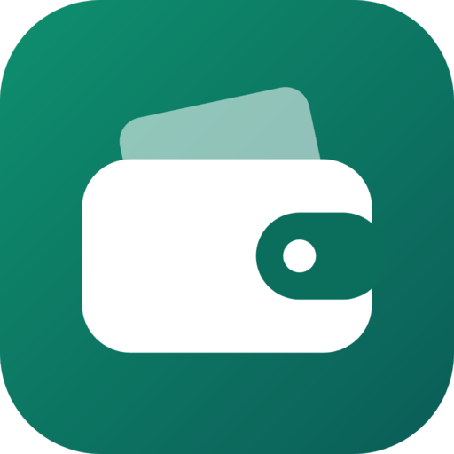

<p align="center">
  
</p>

<h1 align="center">Wallet</h1>

<p align="center">
  <strong>A free, private money tracker for Android, by Minute Campus.</strong><br />
  Works offline with no account. Sign in only if you want a backup and sync.
</p>

<p align="center">
  <a href="https://wallet.minutecampus.com/download"><strong>Download for Android</strong></a> ·
  <a href="https://wallet.minutecampus.com">Website</a> ·
  <a href="https://github.com/dhruba-datta/wallet-by-minute-campus/releases">All releases</a>
</p>

---

This repository holds Wallet's **releases only**: each one has the Android app (`wallet.apk`)
and the small `latest.json` file the app reads to offer updates. Wallet's source code is not
public.

## Install

1. On your Android phone, open **[wallet.minutecampus.com/download](https://wallet.minutecampus.com/download)**
   (or download `wallet.apk` from the [latest release](https://github.com/dhruba-datta/wallet-by-minute-campus/releases/latest)).
2. Open the downloaded file. If Android asks, allow your browser to **install unknown apps**,
   then tap **Install**.
3. Open Wallet. No account is needed to start.

Wallet needs Android 7.0 or newer on a 64-bit (arm64) phone, which is almost every phone from
the last several years.

## Updates

Wallet checks this repository for a newer release and offers to install it
(Menu → Check for Updates). Updates install over the existing app and keep your data.

## Checking the download

Every release is signed with the same key. Android refuses an update signed with any other
key, and you can check a download yourself:

```
apksigner verify --print-certs wallet.apk
```

The certificate's SHA-256 digest must be:

```
c7b596dac30539c6922307386dc75f3d3604e719ceff1e79fafe1a43a2a19d65
```

## Privacy

Without an account, everything stays on your phone. With an account, a copy is kept on
Wallet's server so you can use it on another phone. No ads, no tracking, and your data is never
sold or shared. Read the [privacy policy](https://wallet.minutecampus.com/privacy), or
[delete your account](https://wallet.minutecampus.com/delete-account).

## Help

Questions, problems or ideas: [wallet@minutecampus.com](mailto:wallet@minutecampus.com), or
open an [issue](https://github.com/dhruba-datta/wallet-by-minute-campus/issues).

---

© 2026 Minute Campus. Wallet is free to use; all rights reserved.
